# The Linux Workbench themes

Complete desktop themes for **KDE Plasma 6** and **COSMIC**, each in Dark and Light: colours, apps, icons, cursors, panel, terminal and wallpapers, switched with one command. Made by The Linux Workbench.

**Website:** https://linuxworkbenchstudio.github.io/lwbs-themes/ · **Downloads:** [Releases](https://github.com/linuxworkbenchstudio/lwbs-themes/releases)

## Themes

| Theme | Look | Status |
|---|---|---|
| [**Waypoint**](packs/waypoint) | Graphite and machined amber | Out now (0.1.2) |
| [**Vice Horizon**](packs/vice-horizon) | A sunset palette | Out now (0.1.2) |
| [**Natura**](packs/natura) | Ink, sage and vermillion | Out now (0.1.2) |
| **Vacation** | Ocean, lagoon teal and warm sand | Coming soon |
| **Vintage Trail** | Charcoal, sage, canvas and brass | Coming soon |
| **Core** | Platinum, midnight and soft blue | Coming soon |

### Waypoint

| KDE Plasma 6 | COSMIC |
|---|---|
| 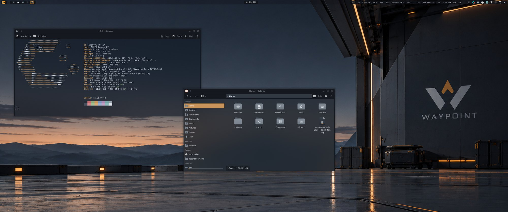 | 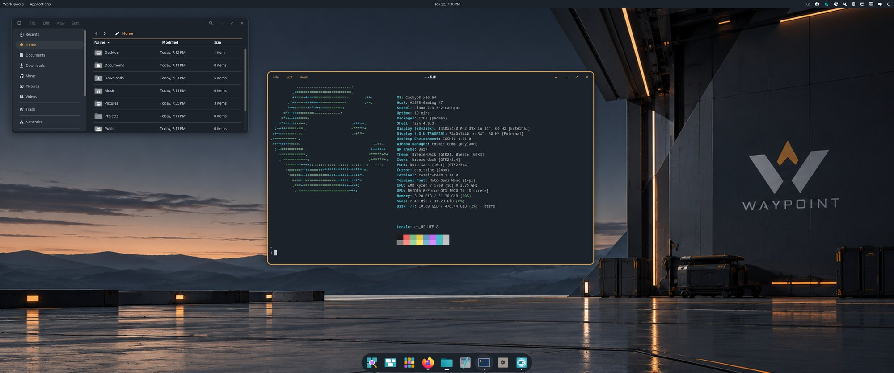 |
| 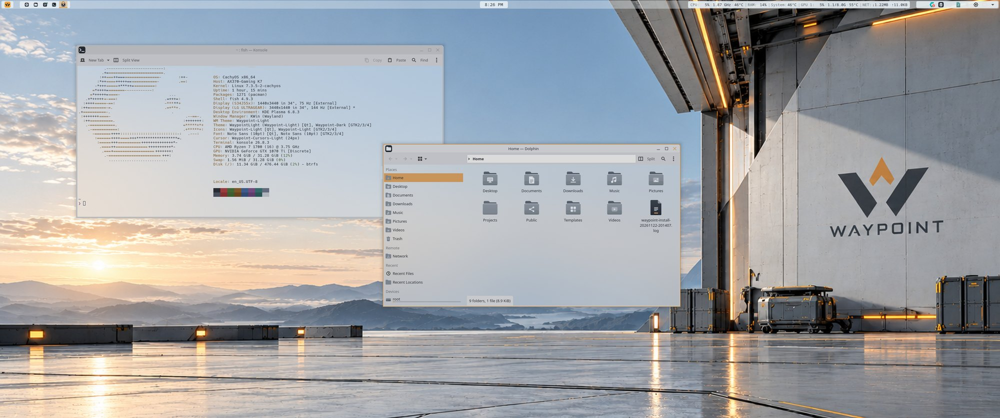 | 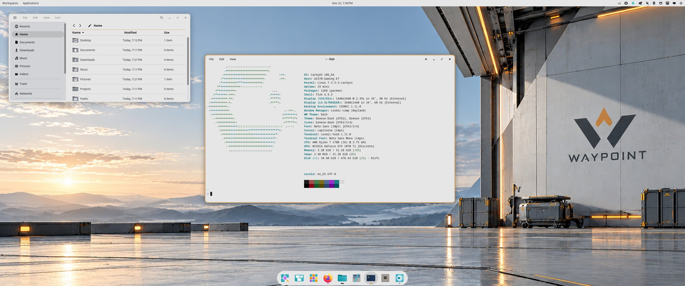 |

### Vice Horizon

| KDE Plasma 6 | COSMIC |
|---|---|
| 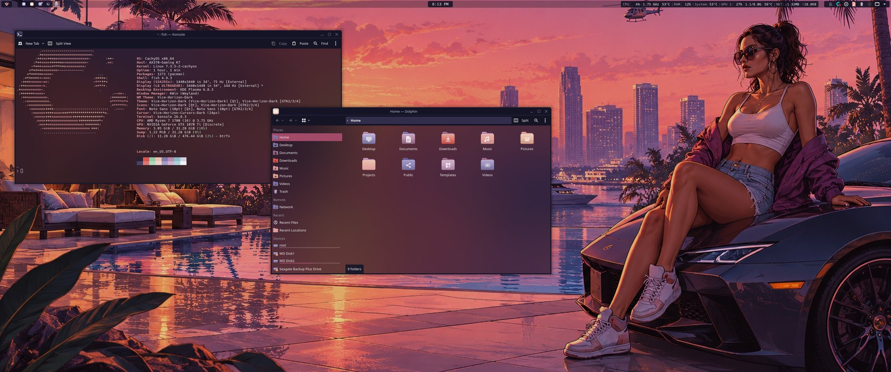 | 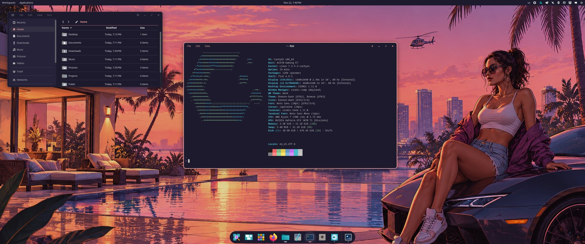 |
| 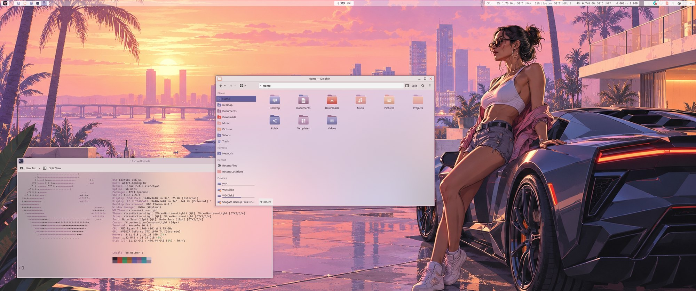 | 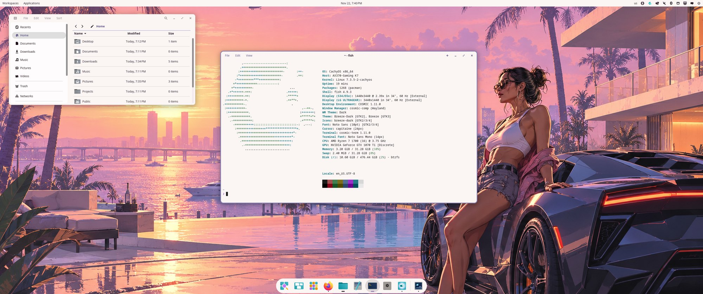 |

### Natura

| KDE Plasma 6 | COSMIC |
|---|---|
| 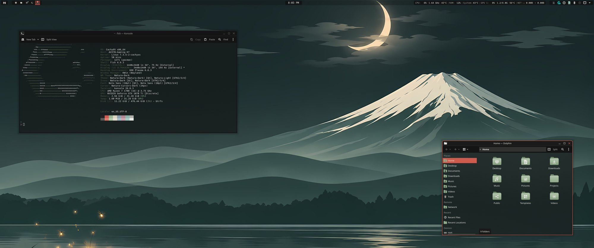 | 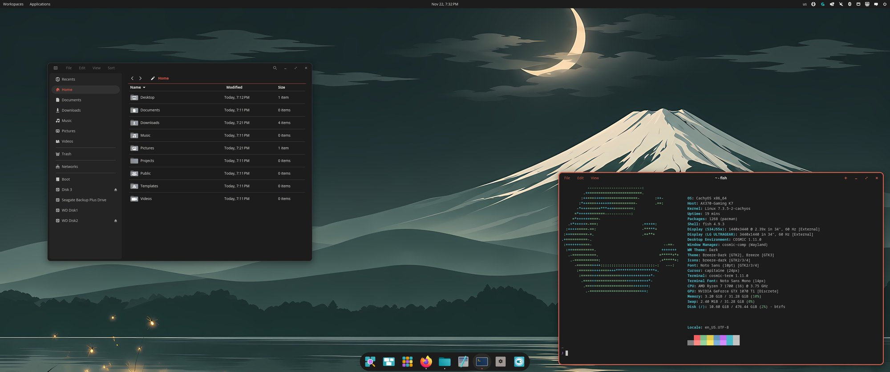 |
| 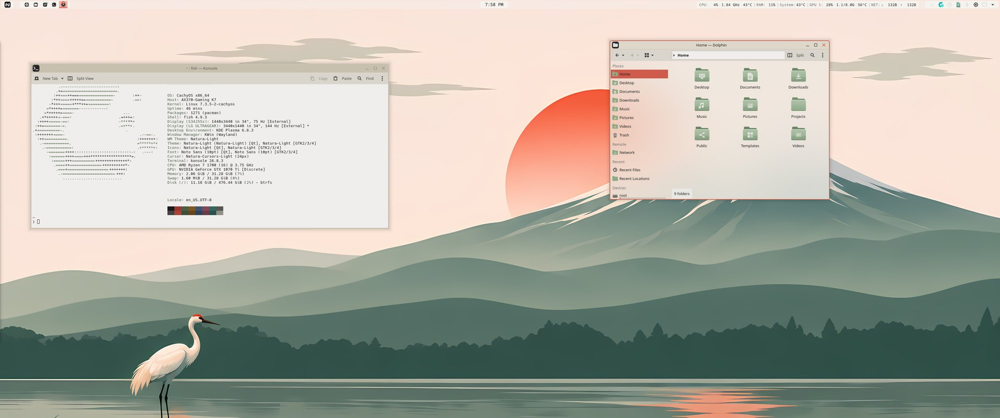 | 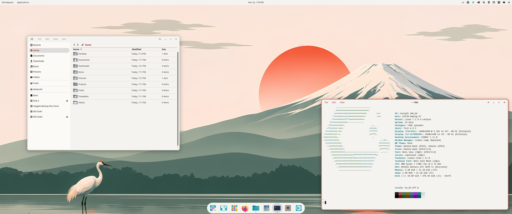 |

## Install

**KDE Plasma 6:** download the theme's full zip from [Releases](https://github.com/linuxworkbenchstudio/lwbs-themes/releases), unzip it, and run `./install.sh`. It is a guided setup in the terminal, and nothing changes until you press Install. Afterwards `<theme> dark` or `<theme> light` switches everything.

**COSMIC:** download the theme's COSMIC zip and run `./install.sh`, then open Settings › Desktop › Appearance, choose Dark or Light, press Import and pick the matching `.ron` file.

Check a download: `sha256sum -c --ignore-missing CHECKSUMS.sha256`

### Needs (KDE panel)

The top panel uses two widgets made by other people. The themes don't bundle or change them; the installer checks for both and asks before it fetches anything (AUR with yay or paru, otherwise the KDE Store, for your user only). Without them the theme still installs and the panel is plainer.

- **Panel Colorizer** by Luis Bocanegra: gives the panel its look. [KDE Store](https://store.kde.org/p/2130967) · [GitHub](https://github.com/luisbocanegra/plasma-panel-colorizer)
- **KVitals** by Yassine Amjad: CPU, RAM, GPU and network stats (needs lm_sensors). [KDE Store](https://store.kde.org/p/2347917) · [GitHub](https://github.com/yassine20011/kvitals)

## Help

Questions or problems: [GitHub Issues](https://github.com/linuxworkbenchstudio/lwbs-themes/issues). Code is GPL-3.0-or-later; wallpapers are all rights reserved (free to use as wallpapers).
